

# مِركاز | Mirkaz

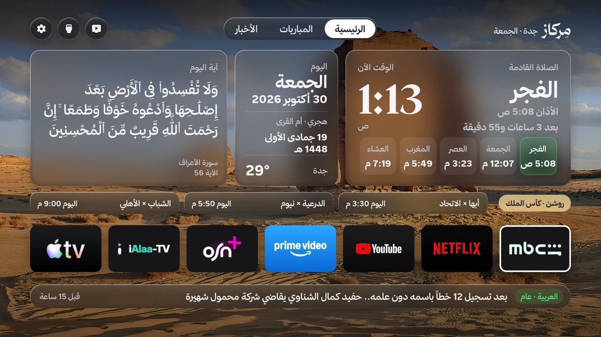

**مِركاز** واجهة رئيسية عربية لتلفزيونات Google TV و Android TV. فيها مواقيت الصلاة والأذان، وآية أو حديث كل يوم، والمباريات وترتيب الدوري، وآخر الأخبار، والطقس، وخلفيات من معالم السعودية تتغيّر كل يوم. ورفّ تطبيقاتك المفضلة على بُعد ضغطة.

| | |
|:---:|:---:|
| 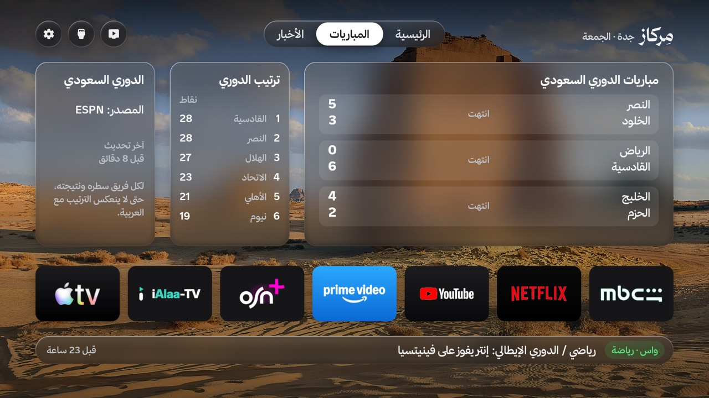 **المباريات وترتيب الدوري** | 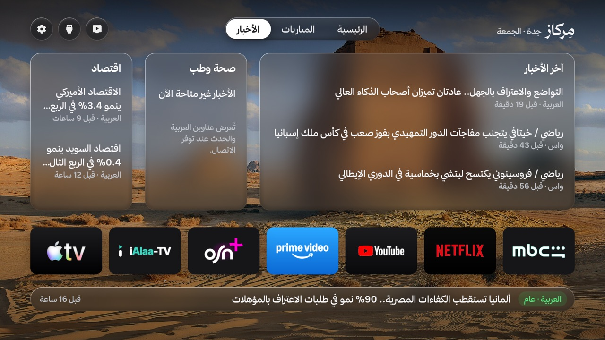 **الأخبار من مصادرك** |
| 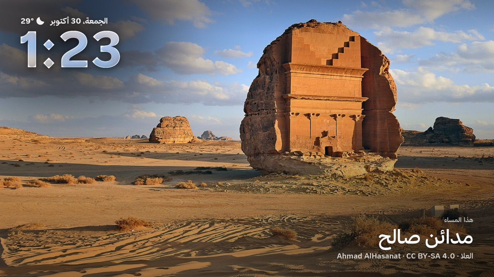 **شاشة التوقف بمعالم سعودية** | 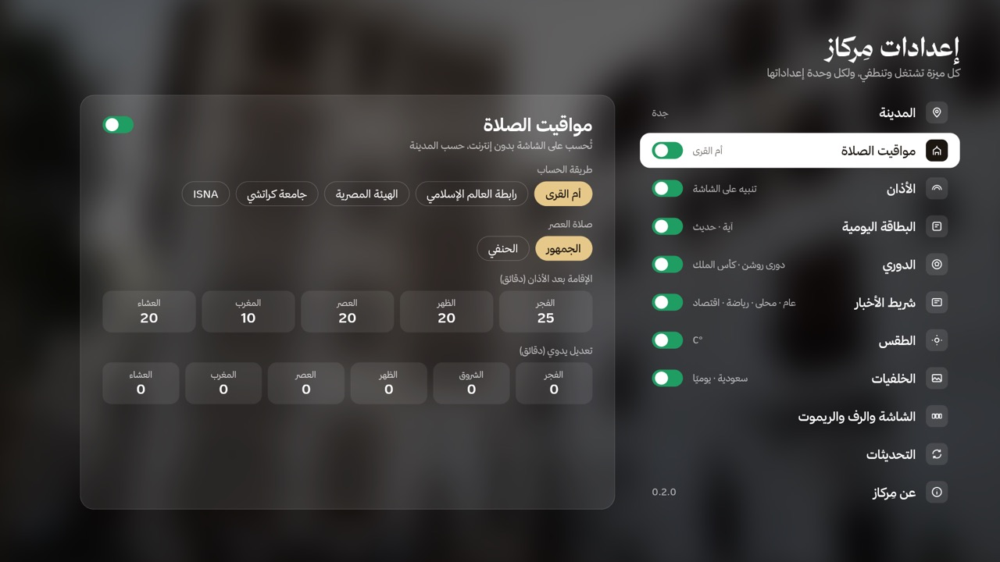 **كل ميزة تشتغل وتنطفي على كيفك** |

## ✨ المزايا

- **مواقيت الصلاة** حسب مدينتك، بطريقة أم القرى أو غيرها، مع وقت الإقامة. تُحسب على التلفزيون نفسه بدون إنترنت.
- **تنبيه الأذان** يظهر على الشاشة وقت الصلاة.
- **البطاقة اليومية**: آية أو حديث من مصادر موثقة.
- **المباريات**: دوري روشن وكأس الملك وأبطال آسيا وأوروبا والدوريات الأوروبية، تختار منها اللي يهمك.
- **شريط الأخبار**: تختار المصادر (العربية، الحدث، واس، سبق…) والمواضيع، وتضيف كلماتك الخاصة.
- **الطقس** لمدينتك، و**خلفيات سعودية** تتغيّر كل يوم مع اسم المكان والمصوّر.
- **رفّ التطبيقات**: تطبيقاتك المفضلة في الواجهة، بالترتيب اللي يناسبك.
- **تحديث من داخل التطبيق** بضغطة زر.

---

## 📺 طريقة التثبيت

تحتاج تطبيق **Downloader** مرة وحدة، وبعدها تكتب كود مِركاز:

<table><tr><td align="center">

**كود مِركاز في Downloader**

# `5373662`

أو الرابط المختصر من أي متصفح: **aftv.news/5373662**

</td></tr></table>

### ١. ثبّت تطبيق Downloader

افتح **Google Play** في التلفزيون، وابحث عن **Downloader**، واضغط **تثبيت**.

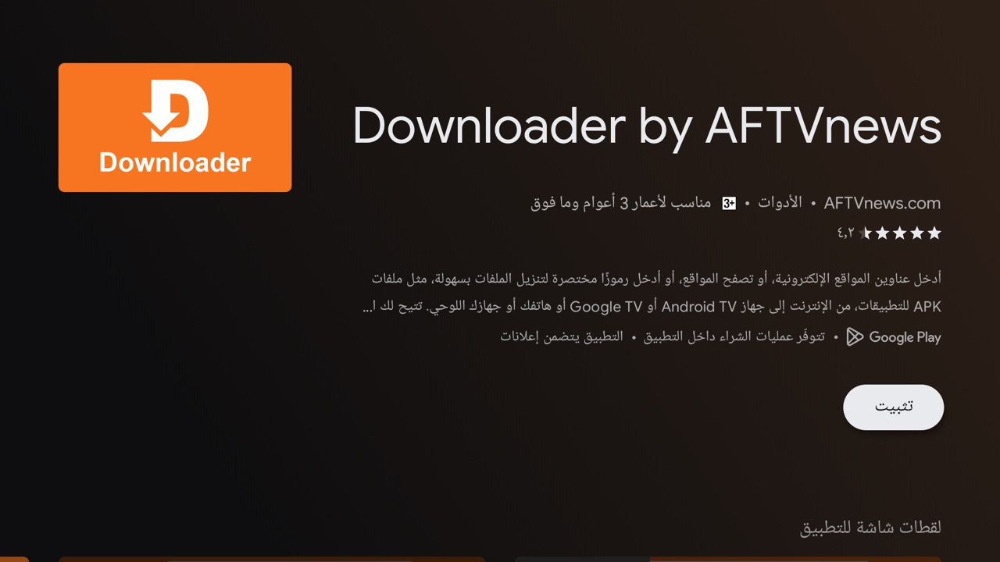

### ٢. اكتب كود مِركاز

افتح **Downloader**، واضغط على خانة العنوان في الأعلى، واكتب **5373662**، ثم اضغط **Load**.

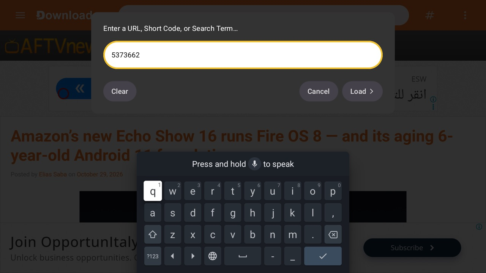

### ٣. انتظر التحميل

ينقلك Downloader تلقائيًا إلى رابط مِركاز، ويبدأ التحميل. ما تحتاج تضغط شي.

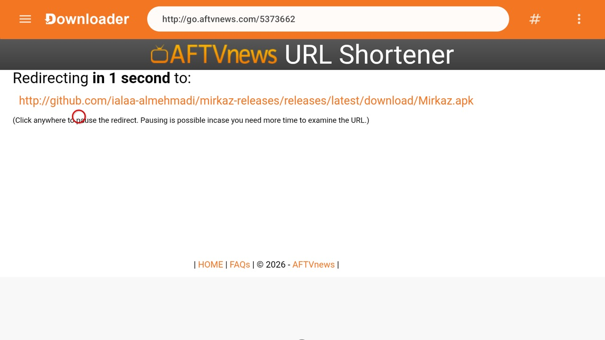

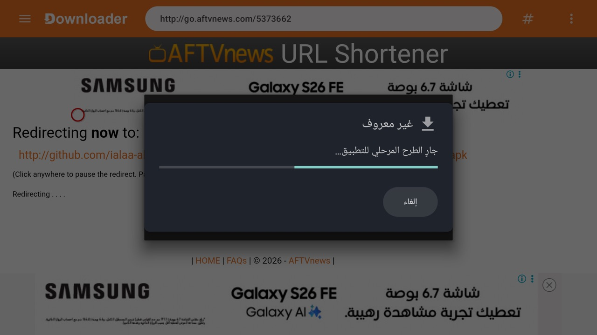

### ٤. اسمح لـ Downloader بالتثبيت (أول مرة بس)

أول مرة يطلع لك تنبيه إن التلفزيون ما يسمح بتثبيت التطبيقات من هذا المصدر. اضغط **الإعدادات**.

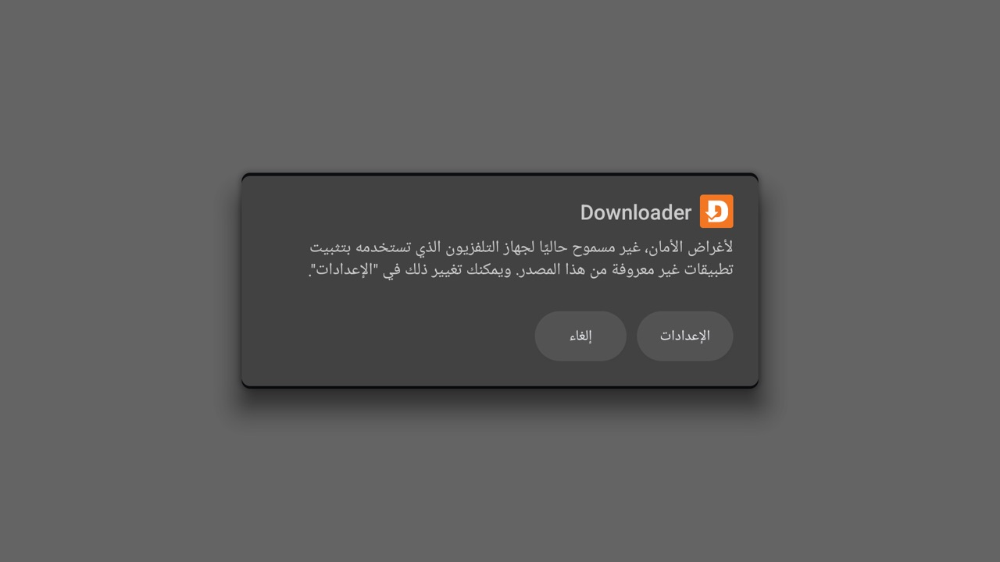

في قائمة **تثبيت التطبيقات غير المعروفة**، فعّل الخيار جنب **Downloader**، ثم ارجع بزر الرجوع في الريموت.

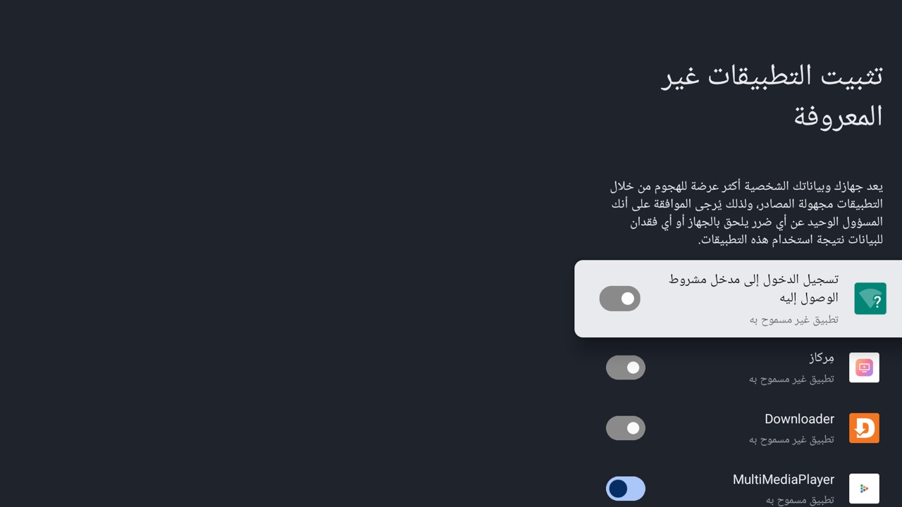

### ٥. ثبّت مِركاز

يطلع لك سؤال تثبيت مِركاز: اضغط **تثبيت**، وبعد ما يخلص اضغط **فتح**.

> إذا طلعت رسالة **Google Play Protect** تقترح فحص التطبيق، اختر **مزيد من التفاصيل** ثم **التثبيت بدون فحص**. مِركاز موقّع بمفتاح مطوّره، والتلفزيون يرفض أي نسخة معدّلة منه.

بعد التثبيت ممكن يسألك Downloader تحذف ملف التحميل: اضغط **حذف**. التطبيق ما يتأثر.

### ٦. خلّه الشاشة الرئيسية

مِركاز يشتغل من قائمة التطبيقات مباشرة. ولو تبيه يكون **الشاشة الرئيسية** للتلفزيون بدل واجهة جوجل، فهذا إعداد يتسوّى مرة وحدة من كمبيوتر على نفس الشبكة. تواصل معي وأساعدك فيه.

---

## 🔄 التحديث

من داخل مِركاز: **الإعدادات ← التحديثات ← تحقّق من التحديث**.
إذا فيه نسخة جديدة يظهر رقمها وزر **حدّث الآن**: اضغطه، ووافق على رسالة التثبيت.

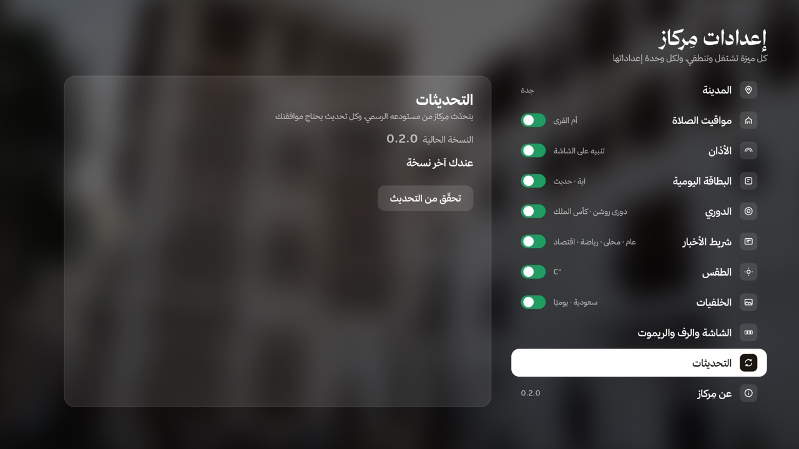

أول تحديث بس يطلب منك التلفزيون السماح لـ **مِركاز** بتثبيت التطبيقات: فعّله من نفس القائمة في الخطوة ٤، وارجع واضغط **حدّث الآن** مرة ثانية.

كل النسخ وملاحظاتها في صفحة [الإصدارات](https://github.com/ialaa-almehmadi/mirkaz-releases/releases).

---

## 💬 تواصل

تصميم وتطوير **علاء المحمادي**
X و TikTok: **[@alaa_mehmadi](https://x.com/alaa_mehmadi)**

© 2026 علاء المحمادي. جميع الحقوق محفوظة.
الصور في الخلفيات لأصحابها حسب رخصها، وخط ثمانية من [font.thmanyah.com](https://font.thmanyah.com).

